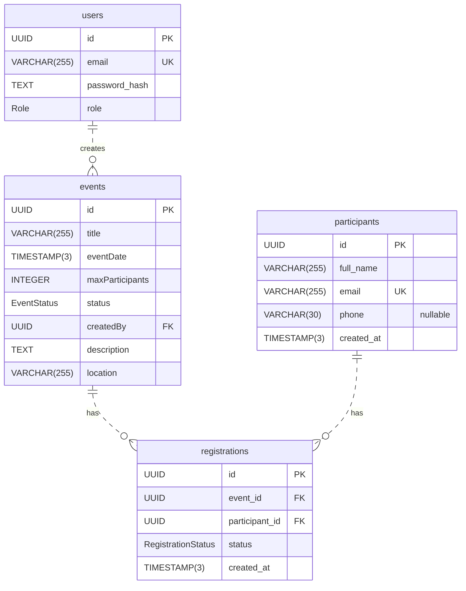

# EventHub Database ERD

This diagram describes the PostgreSQL tables created by the checked-in [Prisma schema](../server/prisma/schema.prisma) and [SQL migrations](../server/prisma/migrations/). Names below are database column names, including the camelCase columns in `events`.

## Entity relationships

`||` means exactly one; `o{` means zero or many. Each Event has exactly one creator. Each Registration belongs to exactly one Event and one Participant. Dashed lines indicate non-identifying relationships: foreign keys are not part of the child table's primary key.

`PK` denotes a primary key, `FK` a foreign key, and `UK` a single-column unique key. The composite unique index on `(event_id, participant_id)` is documented separately below; neither column is individually unique. All columns are `NOT NULL` except `participants.phone`.

## PostgreSQL enums and defaults

| Type | Values |
| --- | --- |
| `Role` | `staff`, `admin` |
| `EventStatus` | `draft`, `published`, `cancelled` |
| `RegistrationStatus` | `pending`, `confirmed`, `cancelled` |

- `events.status` defaults to `draft`.
- `registrations.status` defaults to `pending`.
- `participants.created_at` and `registrations.created_at` default to `CURRENT_TIMESTAMP`.
- All IDs use Prisma's `uuid()` default. The migration SQL defines UUID columns without a database-side UUID default; Prisma generates these values.
- `TIMESTAMP(3)` is PostgreSQL timestamp without time zone, with millisecond precision. The schema does not use `TIMESTAMPTZ`.

## Keys and indexes

Primary key constraints are `users_pkey`, `events_pkey`, `participants_pkey`, and `registrations_pkey`, each on `id`.

| Table | Index name | Columns | Kind |
| --- | --- | --- | --- |
| `users` | `users_email_key` | `email` | Unique |
| `events` | `events_createdBy_idx` | `createdBy` | Non-unique |
| `events` | `events_status_eventDate_idx` | `status`, `eventDate` | Non-unique, composite |
| `participants` | `participants_email_key` | `email` | Unique |
| `registrations` | `registrations_participant_id_idx` | `participant_id` | Non-unique |
| `registrations` | `registrations_event_id_participant_id_key` | `event_id`, `participant_id` | Unique, composite |

The migrations create the uniqueness rules as unique indexes. The Event/Participant pair remains unique for cancelled Registrations as well. No partial indexes or SQL `CHECK` constraints are defined in these migrations.

## Foreign keys and referential actions

| Constraint | Child column | Referenced column | On delete | On update |
| --- | --- | --- | --- | --- |
| `events_createdBy_fkey` | `events.createdBy` | `users.id` | `RESTRICT` | `CASCADE` |
| `registrations_event_id_fkey` | `registrations.event_id` | `events.id` | `RESTRICT` | `CASCADE` |
| `registrations_participant_id_fkey` | `registrations.participant_id` | `participants.id` | `RESTRICT` | `CASCADE` |

Referenced rows cannot be deleted while child rows exist. Event cancellation updates Registration statuses in application code; it is not a database deletion cascade. Capacity checks and permitted status transitions are also enforced by the backend, rather than SQL `CHECK` constraints.

## Prisma and SQL comparison

The schema and migrations agree on tables, column mappings, types, nullability, enum values, indexes, and relationships. The following representation differences are expected:

- Prisma uses `passwordHash`, `fullName`, `createdAt`, `eventId`, and `participantId` in code; `@map` translates them to the snake_case database columns shown above. The Event fields `eventDate`, `maxParticipants`, and `createdBy` retain their camelCase database names.
- Prisma's `uuid()` defaults are generated by Prisma, so they do not appear as SQL column defaults.
- Prisma explicitly specifies `onDelete: Restrict` and leaves `onUpdate` implicit; the SQL migrations explicitly specify `ON DELETE RESTRICT ON UPDATE CASCADE`.
- Prisma `String`, `Int`, and `DateTime` map to the SQL types shown in the diagram. `@default(now())` maps to `CURRENT_TIMESTAMP`.

## Diagram format

The diagram uses a standard fenced `mermaid` block with `erDiagram`, documented cardinality notation, attribute types, and key markers. It follows [Mermaid's ER syntax](https://mermaid.js.org/syntax/entityRelationshipDiagram.html) and [GitHub's Markdown diagram format](https://docs.github.com/en/get-started/writing-on-github/working-with-advanced-formatting/creating-diagrams), without plugins or custom extensions.
